

<picture><source media="(prefers-color-scheme: dark)" srcset="./assets/readme/dark/hero.svg"></picture>

<a href="#flagship">Flagship</a> &nbsp;·&nbsp; <a href="#selected-work">Selected work</a> &nbsp;·&nbsp; <a href="#also-building">Also building</a> &nbsp;·&nbsp; <a href="#engineering-with-ai">Engineering with AI</a> &nbsp;·&nbsp; <a href="#stack">Stack</a> &nbsp;·&nbsp; <a href="#contact">Contact</a>

 

I'm **Samudra Kar**, a computer science student at Chanakya University in Bangalore. I like work where the engineering and the interface have to agree: operating systems, local AI, computer vision, product engineering, UI/UX and developer tools. I'm looking for internships. Below are the eight projects I'd most like you to open, and what is actually inside each one.

 

<picture><source media="(prefers-color-scheme: dark)" srcset="./assets/readme/dark/sec-flagship.svg"></picture>

<a href="https://github.com/Samudra-GITHub/W.E.D.N.E.S.D.A.Y."><picture><source media="(prefers-color-scheme: dark)" srcset="./assets/readme/dark/wed-hero.svg"></picture></a>

**[W.E.D.N.E.S.D.A.Y.](https://github.com/Samudra-GITHub/W.E.D.N.E.S.D.A.Y.)** is a desktop assistant for Windows 11 that answers with a language model running on your own machine through Ollama. It can use tools (the time, your workspace, earthquakes, weather, nearby places), but every call goes through a capability broker that denies by default, and anything with consequences waits for your approval. Around it sits a 3D Earth of live public data, and a Moon.

- **A living Earth.** A CesiumJS globe lit by the real sun, with live aircraft, tracked satellites, USGS earthquakes, NASA EONET events and GDACS alerts, each layer showing its source and how fresh it is.
- **Ask the Earth.** Plain-language questions become typed requests the globe must confirm. The model can't send code, and records it invents are flagged.
- **Private by design.** Local model, local speech, push-to-talk with no wake word, and a core that listens only on `127.0.0.1`.

`Python` · `FastAPI` · `React` · `CesiumJS` · `Ollama` &nbsp;·&nbsp; **[Repository →](https://github.com/Samudra-GITHub/W.E.D.N.E.S.D.A.Y.)**

 

<picture><source media="(prefers-color-scheme: dark)" srcset="./assets/readme/dark/sec-selected.svg"></picture>

<a href="https://github.com/Samudra-GITHub/discreta"><picture><source media="(prefers-color-scheme: dark)" srcset="./assets/readme/dark/discreta.svg"></picture></a>

**[DISCRETA](https://github.com/Samudra-GITHub/discreta)** is a classical cryptography and frequency-analysis laboratory, built with Shriyanshu Rout Roy as team BugSquad. You encrypt and decrypt with the Caesar, affine and Vigenère ciphers, then attack the ciphertext with letter frequencies, χ², the index of coincidence and Kasiski examination. Every ranking is labelled as measured, calculated or a suggestion, and never as proof. The number theory (gcd, extended Euclid, modular inverse) is written from scratch and checked against independent implementations: **1,410 backend and 262 frontend tests pass**. It ships with an academic [project report](https://github.com/Samudra-GITHub/discreta/blob/main/docs/report/DISCRETA_Project_Report.pdf), an API reference and mathematics notes. I implemented the software, tests and documentation; Shriyanshu did the mathematics research and review.

`Python` · `FastAPI` · `React 19` · `TypeScript` &nbsp;·&nbsp; **[Repository →](https://github.com/Samudra-GITHub/discreta)**

 

<a href="https://github.com/Samudra-GITHub/waymark"><picture><source media="(prefers-color-scheme: dark)" srcset="./assets/readme/dark/waymark.svg"></picture></a>

**[Waymark](https://github.com/Samudra-GITHub/waymark)** is an India-first travel discovery and trip-planning app. Start with a mood, a collection or a region, then turn a place into a plan: an editable itinerary, a map of the places you've pinned and a per-person budget in ₹ that always says it is an estimate. It never invents live prices, availability or weather.

`React 19` · `TypeScript` · `Tailwind 4` · `Leaflet` &nbsp;·&nbsp; **[Repository →](https://github.com/Samudra-GITHub/waymark)**

 

<table>
<tr><td width="50%" valign="top"><a href="https://github.com/Samudra-GITHub/arthayukti"><picture><source media="(prefers-color-scheme: dark)" srcset="./assets/readme/dark/arthayukti.svg"></picture></a> Multi-goal financial planning under uncertainty: when income can't cover every goal, it shows which goal slips, by how long, and the smallest fix, and the engine re-checks every fix. An AI advisor explains the trade-offs; the engine does the arithmetic. English and हिन्दी. Built for Srujana Hackathon 2026. FastAPI · React · TypeScript · Tailwind · Gemini &nbsp;·&nbsp; <a href="https://github.com/Samudra-GITHub/arthayukti">GitHub ↗</a> &nbsp;·&nbsp; <a href="https://arthayukti.vercel.app">Live ↗</a></td><td width="50%" valign="top"><a href="https://github.com/Samudra-GITHub/AkashaLens"><picture><source media="(prefers-color-scheme: dark)" srcset="./assets/readme/dark/akashalens.svg"></picture></a> A PyTorch U-Net prototype that reconstructs cloud-covered Sentinel-2 satellite scenes. Built for ISRO Hackathon 2026, and trained on a tiny sample set. PyTorch · scikit-image · Flask &nbsp;·&nbsp; <a href="https://github.com/Samudra-GITHub/AkashaLens">GitHub ↗</a></td></tr>
<tr><td width="50%" valign="top"><a href="https://github.com/Samudra-GITHub/Rinti-Ai"><picture><source media="(prefers-color-scheme: dark)" srcset="./assets/readme/dark/rinti-ai.svg"></picture></a> A chat workspace with per-user memory, cited multi-step research and real account sessions: Argon2 hashing, HttpOnly cookies, CSRF checks. FastAPI · Next.js · Groq · Tavily &nbsp;·&nbsp; <a href="https://github.com/Samudra-GITHub/Rinti-Ai">GitHub ↗</a> &nbsp;·&nbsp; <a href="https://rinti-ai.vercel.app">Live ↗</a></td><td width="50%" valign="top"><a href="https://github.com/Samudra-GITHub/Tarang"><picture><source media="(prefers-color-scheme: dark)" srcset="./assets/readme/dark/tarang.svg"></picture></a> A music web app built around one persistent player that expands into a full now-playing view, with time-synced lyrics and a documented design system. Frontend only, on seed data. Next.js · TypeScript · Framer Motion · Zustand &nbsp;·&nbsp; <a href="https://github.com/Samudra-GITHub/Tarang">GitHub ↗</a> &nbsp;·&nbsp; <a href="https://tarang-ecru.vercel.app">Live ↗</a></td></tr>
</table>

The readings inside the cards are illustrative, not live data. More work: [PRAHARI](https://github.com/Samudra-GITHub/PRAHARI) (mine-safety monitoring, Smart India Hackathon) · [Krama](https://github.com/Samudra-GITHub/Krama) · [Niriksh AI](https://github.com/Samudra-GITHub/Niriksh-AI) · [SkyCast](https://github.com/Samudra-GITHub/SkyCast-Weather-App) · [orbit-os](https://github.com/Samudra-GITHub/orbit-os) · [noir-cafe](https://github.com/Samudra-GITHub/noir-cafe) · [Sam's Portfolio](https://github.com/Samudra-GITHub/Sam-s_Portfolio) ([live](https://sam-sportfolio.vercel.app)) · [speed-of-numbers-fca](https://github.com/Samudra-GITHub/speed-of-numbers-fca)

 

<picture><source media="(prefers-color-scheme: dark)" srcset="./assets/readme/dark/sec-systems.svg"></picture>

<a href="https://github.com/Samudra-GITHub/Samagra-OS"><picture><source media="(prefers-color-scheme: dark)" srcset="./assets/readme/dark/samagra-os.svg"></picture></a>

**[Samagra OS](https://github.com/Samudra-GITHub/Samagra-OS)** is a real x86-64 operating system, built from first principles. It boots into long mode, manages physical and virtual memory, handles CPU exceptions and hardware interrupts, and runs a preemptive scheduler over kernel tasks. Early user-mode support has started: Ring 3, per-process address spaces, a small system-call interface and a non-persistent RAM filesystem. Persistent storage, networking and a native desktop are still to come.

 

<picture><source media="(prefers-color-scheme: dark)" srcset="./assets/readme/dark/sec-ai.svg"></picture>

<picture><source media="(prefers-color-scheme: dark)" srcset="./assets/readme/dark/ai-workflow.svg"></picture>

Claude Code and Antigravity are AI engineering agents, not people. I use them as part of my workflow, not as a replacement for engineering decisions: I set the architecture, direction and validation, and they implement. They coordinate through the repository itself: shared docs, interface contracts, handoff notes and commits.

 

<picture><source media="(prefers-color-scheme: dark)" srcset="./assets/readme/dark/sec-stack.svg"></picture>

<picture><source media="(prefers-color-scheme: dark)" srcset="./assets/readme/dark/stack.svg"></picture>

 

<picture><source media="(prefers-color-scheme: dark)" srcset="./assets/readme/dark/sec-contact.svg"></picture>

<picture><source media="(prefers-color-scheme: dark)" srcset="./assets/readme/dark/closing.svg"></picture>

<a href="https://sam-sportfolio.vercel.app">Portfolio</a> &nbsp;·&nbsp; <a href="https://www.linkedin.com/in/samudra-kar-a495951b5/">LinkedIn</a> &nbsp;·&nbsp; <a href="https://github.com/Samudra-GITHub">GitHub</a> &nbsp;·&nbsp; <a href="mailto:hi.samsstudio@gmail.com">Email</a>

<b>About this page</b>

 

Every picture here is an SVG drawn by <code>tools/build_readme.py</code>, in a light and a dark version that follow your GitHub theme. The look follows my <a href="https://sam-sportfolio.vercel.app">portfolio</a>: ivory and graphite with violet and cobalt accents, and a chrome ribbon rendered in Python from a twisted strip. Headline type is Sora, converted to paths so it renders the same everywhere. There are no scripts and no external resources, and every scene reads as a finished composition with motion turned off.

