<h1 align="center"></h1>

<a href="#currently-building">Currently building</a> &nbsp;·&nbsp; <a href="#selected-work">Selected work</a> &nbsp;·&nbsp; <a href="#all-repositories">All repositories</a> &nbsp;·&nbsp; <a href="#engineering-with-ai">Engineering with AI</a> &nbsp;·&nbsp; <a href="#stack">Stack</a> &nbsp;·&nbsp; <a href="#contact">Contact</a>

## Currently building

<a href="https://github.com/Samudra-GITHub/Samagra-OS"></a>

A real x86-64 operating system, built from first principles. It boots into long mode, manages physical and virtual memory, handles CPU exceptions and hardware interrupts, and runs a preemptive scheduler over kernel tasks. Early user-mode support has started: Ring 3, per-process address spaces, a small system-call interface and a non-persistent RAM filesystem. Persistent storage, networking and a native desktop are still to come. 
C · x86-64 assembly · Clang / LLD / NASM · QEMU &nbsp;·&nbsp; [GitHub ↗](https://github.com/Samudra-GITHub/Samagra-OS)

## Selected work

<a href="https://github.com/Samudra-GITHub/PRAHARI"></a>

Mine safety and compliance monitoring: explainable risk scores, a tamper-evident audit log, and a copilot limited to permission-scoped data. Built for the Smart India Hackathon. 
Next.js · Prisma · PostgreSQL · Docker &nbsp;·&nbsp; [GitHub ↗](https://github.com/Samudra-GITHub/PRAHARI)

<a href="https://github.com/Samudra-GITHub/AkashaLens"></a>

A PyTorch U-Net prototype that reconstructs cloud-covered Sentinel-2 satellite scenes. Built for ISRO Hackathon 2026, and trained on a tiny sample set. 
PyTorch · scikit-image · Flask &nbsp;·&nbsp; [GitHub ↗](https://github.com/Samudra-GITHub/AkashaLens)

<a href="https://github.com/Samudra-GITHub/Tarang"></a>

A music web app built around one persistent player that expands into a full now-playing view, with time-synced lyrics and a documented design system. Frontend only, on seed data. 
Next.js · TypeScript · Framer Motion · Zustand &nbsp;·&nbsp; [GitHub ↗](https://github.com/Samudra-GITHub/Tarang) &nbsp;·&nbsp; [Live ↗](https://tarang-ecru.vercel.app)

<a href="https://github.com/Samudra-GITHub/Rinti-Ai"></a>

A chat workspace with per-user memory, cited multi-step research and real account sessions: Argon2 hashing, HttpOnly cookies, CSRF checks. 
FastAPI · Next.js · Groq · Tavily &nbsp;·&nbsp; [GitHub ↗](https://github.com/Samudra-GITHub/Rinti-Ai) &nbsp;·&nbsp; [Live ↗](https://rinti-ai.vercel.app)

<a href="https://github.com/Samudra-GITHub/orbit-os"></a>

A personal dashboard that borrows from operating-system design. An interface exploration with mock data, not a real operating system. 
Next.js · TypeScript · Framer Motion &nbsp;·&nbsp; [GitHub ↗](https://github.com/Samudra-GITHub/orbit-os)

## All repositories


Open the full list with links

| Repository | What it is |
|---|---|
| [Samagra-OS](https://github.com/Samudra-GITHub/Samagra-OS) | x86-64 operating system, from scratch |
| [PRAHARI](https://github.com/Samudra-GITHub/PRAHARI) | Mine safety and compliance monitoring |
| [AkashaLens](https://github.com/Samudra-GITHub/AkashaLens) | Cloud removal for Sentinel-2 imagery |
| [Tarang](https://github.com/Samudra-GITHub/Tarang) | Music-first web app on seed data |
| [Rinti-Ai](https://github.com/Samudra-GITHub/Rinti-Ai) | Research chat with memory and citations |
| [orbit-os](https://github.com/Samudra-GITHub/orbit-os) | OS-inspired dashboard, mock data |
| [Krama](https://github.com/Samudra-GITHub/Krama) | Luxury sneaker marketplace |
| [Niriksh-AI](https://github.com/Samudra-GITHub/Niriksh-AI) | AI operations teammate for merchants |
| [SkyCast-Weather-App](https://github.com/Samudra-GITHub/SkyCast-Weather-App) | One-screen weather over OpenWeatherMap |
| [Sam-s_Portfolio](https://github.com/Samudra-GITHub/Sam-s_Portfolio) | Current portfolio site |
| [samudra-kar-portfolio](https://github.com/Samudra-GITHub/samudra-kar-portfolio) | Earlier interactive portfolio |
| [noir-cafe](https://github.com/Samudra-GITHub/noir-cafe) | Cinematic specialty-coffee site |
| [the-waffle-house](https://github.com/Samudra-GITHub/the-waffle-house) | Restaurant landing page |
| [singularity-login](https://github.com/Samudra-GITHub/singularity-login) | Glassmorphism sign-in UI |
| [speed-of-numbers-fca](https://github.com/Samudra-GITHub/speed-of-numbers-fca) | ESP32 numeric-speed team lab |
| [website](https://github.com/Samudra-GITHub/website) | Early website experiment |
| [vyom](https://github.com/Samudra-GITHub/vyom) | Work in progress |
| [Samudra-GITHub](https://github.com/Samudra-GITHub/Samudra-GITHub) | This profile README and its SVG generator |

## Engineering with AI


Claude Code and Antigravity are AI engineering agents, not people. I use them as part of my workflow, not as a replacement for engineering decisions: I set architecture, direction and validation, and they implement. They coordinate through the repository itself: shared docs, interface contracts, handoff notes and commits.

## Stack


**Languages** &nbsp; TypeScript · JavaScript · Python · C · x86-64 Assembly 
**Systems** &nbsp; Clang · LLD · NASM · QEMU · Git · Docker 
**Web** &nbsp; React · Next.js · Tailwind · Framer Motion · GSAP · Three.js 
**AI / Vision** &nbsp; PyTorch · NumPy · SciPy · scikit-image · LLM APIs 
**Design** &nbsp; Figma · Design Systems · Motion Design

**Interests** &nbsp; Systems · AI / Computer Vision · Product Engineering · UI / UX · Developer Tools

## Contact


<a href="https://sam-sportfolio.vercel.app">Portfolio</a> &nbsp;·&nbsp; <a href="https://www.linkedin.com/in/samudra-kar-a495951b5/">LinkedIn</a> &nbsp;·&nbsp; <a href="https://github.com/Samudra-GITHub">GitHub</a> &nbsp;·&nbsp; <a href="mailto:hi.samsstudio@gmail.com">Email</a> &nbsp;·&nbsp; Bangalore, India &nbsp;·&nbsp; Chanakya University &nbsp;·&nbsp; Open to internships

