<h1 align="center"></h1>

<a href="#projects">Projects</a> &nbsp;·&nbsp; <a href="#engineering-with-ai">Engineering with AI</a> &nbsp;·&nbsp; <a href="#stack">Stack</a> &nbsp;·&nbsp; <a href="#contact">Contact</a>

## Projects

Samagra OS is the flagship and the one I am building right now. Every public repository is below, two per row.

<table>
<tr><td width="50%" valign="top"><a href="https://github.com/Samudra-GITHub/Samagra-OS"></a> A real x86-64 operating system, built from first principles. It boots into long mode, manages physical and virtual memory, handles CPU exceptions and hardware interrupts, and runs a preemptive scheduler over kernel tasks. Early user-mode support has started: Ring 3, per-process address spaces, a small system-call interface and a non-persistent RAM filesystem. Persistent storage, networking and a native desktop are still to come. C · x86-64 assembly · Clang / LLD / NASM · QEMU &nbsp;·&nbsp; [GitHub ↗](https://github.com/Samudra-GITHub/Samagra-OS)</td><td width="50%" valign="top"><a href="https://github.com/Samudra-GITHub/PRAHARI"></a> Mine safety and compliance monitoring: explainable risk scores, a tamper-evident audit log, and a copilot limited to permission-scoped data. Built for the Smart India Hackathon. Next.js · Prisma · PostgreSQL · Docker &nbsp;·&nbsp; [GitHub ↗](https://github.com/Samudra-GITHub/PRAHARI)</td></tr>
<tr><td width="50%" valign="top"><a href="https://github.com/Samudra-GITHub/AkashaLens"></a> A PyTorch U-Net prototype that reconstructs cloud-covered Sentinel-2 satellite scenes. Built for ISRO Hackathon 2026, and trained on a tiny sample set. PyTorch · scikit-image · Flask &nbsp;·&nbsp; [GitHub ↗](https://github.com/Samudra-GITHub/AkashaLens)</td><td width="50%" valign="top"><a href="https://github.com/Samudra-GITHub/Tarang"></a> A music web app built around one persistent player that expands into a full now-playing view, with time-synced lyrics and a documented design system. Frontend only, on seed data. Next.js · TypeScript · Framer Motion · Zustand &nbsp;·&nbsp; [GitHub ↗](https://github.com/Samudra-GITHub/Tarang) &nbsp;·&nbsp; [Live ↗](https://tarang-ecru.vercel.app)</td></tr>
<tr><td width="50%" valign="top"><a href="https://github.com/Samudra-GITHub/Rinti-Ai"></a> A chat workspace with per-user memory, cited multi-step research and real account sessions: Argon2 hashing, HttpOnly cookies, CSRF checks. FastAPI · Next.js · Groq · Tavily &nbsp;·&nbsp; [GitHub ↗](https://github.com/Samudra-GITHub/Rinti-Ai) &nbsp;·&nbsp; [Live ↗](https://rinti-ai.vercel.app)</td><td width="50%" valign="top"><a href="https://github.com/Samudra-GITHub/orbit-os"></a> A personal dashboard that borrows from operating-system design. An interface exploration with mock data, not a real operating system. Next.js · TypeScript · Framer Motion &nbsp;·&nbsp; [GitHub ↗](https://github.com/Samudra-GITHub/orbit-os)</td></tr>
<tr><td width="50%" valign="top"><a href="https://github.com/Samudra-GITHub/Krama"></a> A luxury sneaker marketplace, told as a story. Next.js · TypeScript · GSAP &nbsp;·&nbsp; [GitHub ↗](https://github.com/Samudra-GITHub/Krama)</td><td width="50%" valign="top"><a href="https://github.com/Samudra-GITHub/Niriksh-AI"></a> An AI operations teammate for merchants. Next.js · TypeScript &nbsp;·&nbsp; [GitHub ↗](https://github.com/Samudra-GITHub/Niriksh-AI)</td></tr>
<tr><td width="50%" valign="top"><a href="https://github.com/Samudra-GITHub/SkyCast-Weather-App"></a> One screen of weather: conditions, forecast, UV and air quality for any city, over OpenWeatherMap. Python · Flask &nbsp;·&nbsp; [GitHub ↗](https://github.com/Samudra-GITHub/SkyCast-Weather-App)</td><td width="50%" valign="top"><a href="https://github.com/Samudra-GITHub/Sam-s_Portfolio"></a> My current portfolio site. HTML &nbsp;·&nbsp; [GitHub ↗](https://github.com/Samudra-GITHub/Sam-s_Portfolio) &nbsp;·&nbsp; [Live ↗](https://sam-sportfolio.vercel.app)</td></tr>
<tr><td width="50%" valign="top"><a href="https://github.com/Samudra-GITHub/samudra-kar-portfolio"></a> An earlier interactive developer portfolio. TypeScript &nbsp;·&nbsp; [GitHub ↗](https://github.com/Samudra-GITHub/samudra-kar-portfolio)</td><td width="50%" valign="top"><a href="https://github.com/Samudra-GITHub/noir-cafe"></a> A cinematic specialty-coffee site. Next.js · TypeScript · Tailwind · Framer Motion &nbsp;·&nbsp; [GitHub ↗](https://github.com/Samudra-GITHub/noir-cafe)</td></tr>
<tr><td width="50%" valign="top"><a href="https://github.com/Samudra-GITHub/the-waffle-house"></a> A restaurant landing page. TypeScript &nbsp;·&nbsp; [GitHub ↗](https://github.com/Samudra-GITHub/the-waffle-house) &nbsp;·&nbsp; [Live ↗](https://the-waffle-house.vercel.app)</td><td width="50%" valign="top"><a href="https://github.com/Samudra-GITHub/singularity-login"></a> A glassmorphism sign-in UI. Next.js · TypeScript · Tailwind &nbsp;·&nbsp; [GitHub ↗](https://github.com/Samudra-GITHub/singularity-login)</td></tr>
<tr><td width="50%" valign="top"><a href="https://github.com/Samudra-GITHub/speed-of-numbers-fca"></a> A team lab on numeric representation and execution speed on the ESP32. Arduino · TeX &nbsp;·&nbsp; [GitHub ↗](https://github.com/Samudra-GITHub/speed-of-numbers-fca)</td><td width="50%" valign="top"><a href="https://github.com/Samudra-GITHub/website"></a> An early website experiment. HTML &nbsp;·&nbsp; [GitHub ↗](https://github.com/Samudra-GITHub/website)</td></tr>
<tr><td width="50%" valign="top"><a href="https://github.com/Samudra-GITHub/vyom"></a> Work in progress. [GitHub ↗](https://github.com/Samudra-GITHub/vyom)</td><td width="50%" valign="top"><a href="https://github.com/Samudra-GITHub/Samudra-GITHub"></a> This profile README and the generator behind its artwork. Python &nbsp;·&nbsp; [GitHub ↗](https://github.com/Samudra-GITHub/Samudra-GITHub)</td></tr>
</table>

## Engineering with AI

Claude Code and Antigravity are AI engineering agents, not people. I use them as part of my workflow, not as a replacement for engineering decisions: I set architecture, direction and validation, and they implement. They coordinate through the repository itself: shared docs, interface contracts, handoff notes and commits.

## Stack

**Languages** &nbsp; TypeScript · JavaScript · Python · C · x86-64 Assembly 
**Systems** &nbsp; Clang · LLD · NASM · QEMU · Git · Docker 
**Web** &nbsp; React · Next.js · Tailwind · Framer Motion · GSAP · Three.js 
**AI / Vision** &nbsp; PyTorch · NumPy · SciPy · scikit-image · LLM APIs 
**Design** &nbsp; Figma · Design Systems · Motion Design

**Interests** &nbsp; Systems · AI / Computer Vision · Product Engineering · UI / UX · Developer Tools

## Contact

<a href="https://sam-sportfolio.vercel.app">Portfolio</a> &nbsp;·&nbsp; <a href="https://www.linkedin.com/in/samudra-kar-a495951b5/">LinkedIn</a> &nbsp;·&nbsp; <a href="https://github.com/Samudra-GITHub">GitHub</a> &nbsp;·&nbsp; <a href="mailto:hi.samsstudio@gmail.com">Email</a> &nbsp;·&nbsp; Bangalore, India &nbsp;·&nbsp; Chanakya University &nbsp;·&nbsp; Open to internships

