

<picture><source media="(prefers-color-scheme: dark)" srcset="./assets/readme/dark/hero.svg"></picture>

<a href="#flagship">Flagship</a> &nbsp;·&nbsp; <a href="#samagra">Samagra OS</a> &nbsp;·&nbsp; <a href="#projects">All projects</a> &nbsp;·&nbsp; <a href="#engineering-with-ai">Engineering with AI</a> &nbsp;·&nbsp; <a href="#stack">Stack</a> &nbsp;·&nbsp; <a href="#contact">Contact</a>

 

<picture><source media="(prefers-color-scheme: dark)" srcset="./assets/readme/dark/sec-flagship.svg"></picture>

<a href="https://github.com/Samudra-GITHub/W.E.D.N.E.S.D.A.Y."><picture><source media="(prefers-color-scheme: dark)" srcset="./assets/readme/dark/wed-hero.svg"></picture></a>

**[W.E.D.N.E.S.D.A.Y.](https://github.com/Samudra-GITHub/W.E.D.N.E.S.D.A.Y.)** is my flagship: a desktop assistant for Windows 11 that answers with a language model running on your own machine through Ollama. It can use tools (the time, your workspace, earthquakes, weather, nearby places), but every call goes through a capability broker that denies by default, and anything with consequences waits for your approval. Around it sits a full 3D Earth of live public data, and now a Moon.

<a href="https://github.com/Samudra-GITHub/W.E.D.N.E.S.D.A.Y."><picture><source media="(prefers-color-scheme: dark)" srcset="./assets/readme/dark/wed-moon.svg"></picture></a>

<a href="https://github.com/Samudra-GITHub/W.E.D.N.E.S.D.A.Y."><picture><source media="(prefers-color-scheme: dark)" srcset="./assets/readme/dark/wed-pipeline.svg"></picture></a>

<a href="https://github.com/Samudra-GITHub/W.E.D.N.E.S.D.A.Y."><picture><source media="(prefers-color-scheme: dark)" srcset="./assets/readme/dark/wed-modes.svg"></picture></a>

- **A living Earth.** A CesiumJS globe lit by the real sun: live aircraft, about 800 tracked satellites, USGS earthquakes, NASA EONET events, GDACS alerts and more, each layer showing its source and how fresh it is.
- **Lunar Intelligence.** A 3D Moon on NASA Moon Trek LRO imagery, live JPL Horizons positions for LRO, Chandrayaan-2 and Danuri, and an NSSDCA catalogue of landing and impact sites with sources attached.
- **Ask the Earth.** Plain-language questions become typed requests the globe must confirm. The model can't send code, and records it invents are flagged.
- **Time and Orbit.** Play back up to 92 days of history or compare two periods; follow what's in orbit, including the ISS.
- **Private by design.** Local model, local speech, push-to-talk with no wake word, and a core that listens only on `127.0.0.1`.

**[Explore the repository →](https://github.com/Samudra-GITHub/W.E.D.N.E.S.D.A.Y.)**

 

<picture><source media="(prefers-color-scheme: dark)" srcset="./assets/readme/dark/sec-samagra.svg"></picture>

<a href="https://github.com/Samudra-GITHub/Samagra-OS"><picture><source media="(prefers-color-scheme: dark)" srcset="./assets/readme/dark/samagra-os.svg"></picture></a>

**[Samagra OS](https://github.com/Samudra-GITHub/Samagra-OS)** is a real x86-64 operating system, built from first principles. It boots into long mode, manages physical and virtual memory, handles CPU exceptions and hardware interrupts, and runs a preemptive scheduler over kernel tasks. Early user-mode support has started: Ring 3, per-process address spaces, a small system-call interface and a non-persistent RAM filesystem. Persistent storage, networking and a native desktop are still to come.

 

<picture><source media="(prefers-color-scheme: dark)" srcset="./assets/readme/dark/sec-projects.svg"></picture>

Every other public repository, two per row. Each card is a small animated scene of what the project does; the readings inside them are illustrative, not live data.

<table>
<tr><td width="50%" valign="top"><a href="https://github.com/Samudra-GITHub/arthayukti"><picture><source media="(prefers-color-scheme: dark)" srcset="./assets/readme/dark/arthayukti.svg"></picture></a> Multi-goal financial planning under uncertainty: when income can't cover every goal, it shows which goal slips, by how long, and the smallest fix, and the engine re-checks every fix. An AI advisor explains the trade-offs; the engine does the arithmetic. English and हिन्दी. Built for Srujana Hackathon 2026. FastAPI · React · TypeScript · Tailwind · Gemini &nbsp;·&nbsp; <a href="https://github.com/Samudra-GITHub/arthayukti">GitHub ↗</a> &nbsp;·&nbsp; <a href="https://arthayukti.vercel.app">Live ↗</a></td><td width="50%" valign="top"><a href="https://github.com/Samudra-GITHub/PRAHARI"><picture><source media="(prefers-color-scheme: dark)" srcset="./assets/readme/dark/prahari.svg"></picture></a> Mine safety and compliance monitoring: explainable risk scores, a tamper-evident audit log, and a copilot limited to permission-scoped data. Built for the Smart India Hackathon. Next.js · Prisma · PostgreSQL · Docker &nbsp;·&nbsp; <a href="https://github.com/Samudra-GITHub/PRAHARI">GitHub ↗</a></td></tr>
<tr><td width="50%" valign="top"><a href="https://github.com/Samudra-GITHub/AkashaLens"><picture><source media="(prefers-color-scheme: dark)" srcset="./assets/readme/dark/akashalens.svg"></picture></a> A PyTorch U-Net prototype that reconstructs cloud-covered Sentinel-2 satellite scenes. Built for ISRO Hackathon 2026, and trained on a tiny sample set. PyTorch · scikit-image · Flask &nbsp;·&nbsp; <a href="https://github.com/Samudra-GITHub/AkashaLens">GitHub ↗</a></td><td width="50%" valign="top"><a href="https://github.com/Samudra-GITHub/Tarang"><picture><source media="(prefers-color-scheme: dark)" srcset="./assets/readme/dark/tarang.svg"></picture></a> A music web app built around one persistent player that expands into a full now-playing view, with time-synced lyrics and a documented design system. Frontend only, on seed data. Next.js · TypeScript · Framer Motion · Zustand &nbsp;·&nbsp; <a href="https://github.com/Samudra-GITHub/Tarang">GitHub ↗</a> &nbsp;·&nbsp; <a href="https://tarang-ecru.vercel.app">Live ↗</a></td></tr>
<tr><td width="50%" valign="top"><a href="https://github.com/Samudra-GITHub/Rinti-Ai"><picture><source media="(prefers-color-scheme: dark)" srcset="./assets/readme/dark/rinti-ai.svg"></picture></a> A chat workspace with per-user memory, cited multi-step research and real account sessions: Argon2 hashing, HttpOnly cookies, CSRF checks. FastAPI · Next.js · Groq · Tavily &nbsp;·&nbsp; <a href="https://github.com/Samudra-GITHub/Rinti-Ai">GitHub ↗</a> &nbsp;·&nbsp; <a href="https://rinti-ai.vercel.app">Live ↗</a></td><td width="50%" valign="top"><a href="https://github.com/Samudra-GITHub/orbit-os"><picture><source media="(prefers-color-scheme: dark)" srcset="./assets/readme/dark/orbit-os.svg"></picture></a> A personal dashboard that borrows from operating-system design. An interface exploration with mock data, not a real operating system. Next.js · TypeScript · Framer Motion &nbsp;·&nbsp; <a href="https://github.com/Samudra-GITHub/orbit-os">GitHub ↗</a></td></tr>
<tr><td width="50%" valign="top"><a href="https://github.com/Samudra-GITHub/Krama"><picture><source media="(prefers-color-scheme: dark)" srcset="./assets/readme/dark/krama.svg"></picture></a> A luxury sneaker marketplace, told as a story. Next.js · TypeScript · GSAP &nbsp;·&nbsp; <a href="https://github.com/Samudra-GITHub/Krama">GitHub ↗</a></td><td width="50%" valign="top"><a href="https://github.com/Samudra-GITHub/Niriksh-AI"><picture><source media="(prefers-color-scheme: dark)" srcset="./assets/readme/dark/niriksh-ai.svg"></picture></a> An AI operations teammate for merchants. Next.js · TypeScript &nbsp;·&nbsp; <a href="https://github.com/Samudra-GITHub/Niriksh-AI">GitHub ↗</a></td></tr>
<tr><td width="50%" valign="top"><a href="https://github.com/Samudra-GITHub/SkyCast-Weather-App"><picture><source media="(prefers-color-scheme: dark)" srcset="./assets/readme/dark/skycast.svg"></picture></a> One screen of weather: conditions, forecast, UV and air quality for any city, over OpenWeatherMap. Python · Flask &nbsp;·&nbsp; <a href="https://github.com/Samudra-GITHub/SkyCast-Weather-App">GitHub ↗</a></td><td width="50%" valign="top"><a href="https://github.com/Samudra-GITHub/Sam-s_Portfolio"><picture><source media="(prefers-color-scheme: dark)" srcset="./assets/readme/dark/sams-portfolio.svg"></picture></a> My current portfolio: a single-screen WebGL glass-drop homepage, an exhibition of 16 projects with interactive case-study worlds, and an optional generated soundtrack. React 19 · Vite · GSAP · WebGL · Web Audio &nbsp;·&nbsp; <a href="https://github.com/Samudra-GITHub/Sam-s_Portfolio">GitHub ↗</a> &nbsp;·&nbsp; <a href="https://sam-sportfolio.vercel.app">Live ↗</a></td></tr>
<tr><td width="50%" valign="top"><a href="https://github.com/Samudra-GITHub/samudra-kar-portfolio"><picture><source media="(prefers-color-scheme: dark)" srcset="./assets/readme/dark/samudra-kar-portfolio.svg"></picture></a> An earlier interactive developer portfolio. TypeScript &nbsp;·&nbsp; <a href="https://github.com/Samudra-GITHub/samudra-kar-portfolio">GitHub ↗</a> &nbsp;·&nbsp; <a href="https://samudra-kar-portfolio.vercel.app">Live ↗</a></td><td width="50%" valign="top"><a href="https://github.com/Samudra-GITHub/noir-cafe"><picture><source media="(prefers-color-scheme: dark)" srcset="./assets/readme/dark/noir-cafe.svg"></picture></a> A cinematic specialty-coffee site. Next.js · TypeScript · Tailwind · Framer Motion · Lenis &nbsp;·&nbsp; <a href="https://github.com/Samudra-GITHub/noir-cafe">GitHub ↗</a></td></tr>
<tr><td width="50%" valign="top"><a href="https://github.com/Samudra-GITHub/the-waffle-house"><picture><source media="(prefers-color-scheme: dark)" srcset="./assets/readme/dark/the-waffle-house.svg"></picture></a> A restaurant landing page. TypeScript &nbsp;·&nbsp; <a href="https://github.com/Samudra-GITHub/the-waffle-house">GitHub ↗</a> &nbsp;·&nbsp; <a href="https://the-waffle-house.vercel.app">Live ↗</a></td><td width="50%" valign="top"><a href="https://github.com/Samudra-GITHub/singularity-login"><picture><source media="(prefers-color-scheme: dark)" srcset="./assets/readme/dark/singularity-login.svg"></picture></a> A glassmorphism sign-in UI. Next.js · TypeScript · Tailwind &nbsp;·&nbsp; <a href="https://github.com/Samudra-GITHub/singularity-login">GitHub ↗</a></td></tr>
<tr><td width="50%" valign="top"><a href="https://github.com/Samudra-GITHub/speed-of-numbers-fca"><picture><source media="(prefers-color-scheme: dark)" srcset="./assets/readme/dark/speed-of-numbers-fca.svg"></picture></a> A team lab on numeric representation and execution speed on the ESP32. Arduino · TeX &nbsp;·&nbsp; <a href="https://github.com/Samudra-GITHub/speed-of-numbers-fca">GitHub ↗</a></td><td width="50%" valign="top"><a href="https://github.com/Samudra-GITHub/website"><picture><source media="(prefers-color-scheme: dark)" srcset="./assets/readme/dark/website.svg"></picture></a> An early website experiment. HTML &nbsp;·&nbsp; <a href="https://github.com/Samudra-GITHub/website">GitHub ↗</a></td></tr>
<tr><td width="50%" valign="top"><a href="https://github.com/Samudra-GITHub/vyom"><picture><source media="(prefers-color-scheme: dark)" srcset="./assets/readme/dark/vyom.svg"></picture></a> Work in progress. <a href="https://github.com/Samudra-GITHub/vyom">GitHub ↗</a></td><td width="50%" valign="top"><a href="https://github.com/Samudra-GITHub/Samudra-GITHub"><picture><source media="(prefers-color-scheme: dark)" srcset="./assets/readme/dark/samudra-github.svg"></picture></a> This profile README and the generator behind its artwork: every SVG here is drawn by <code>tools/build_readme.py</code>, in a dark and a light version. Python &nbsp;·&nbsp; <a href="https://github.com/Samudra-GITHub/Samudra-GITHub">GitHub ↗</a></td></tr>
</table>

 

<picture><source media="(prefers-color-scheme: dark)" srcset="./assets/readme/dark/sec-ai.svg"></picture>

<picture><source media="(prefers-color-scheme: dark)" srcset="./assets/readme/dark/ai-workflow.svg"></picture>

Claude Code and Antigravity are AI engineering agents, not people. I use them as part of my workflow, not as a replacement for engineering decisions: I set architecture, direction and validation, and they implement. They coordinate through the repository itself: shared docs, interface contracts, handoff notes and commits.

 

<picture><source media="(prefers-color-scheme: dark)" srcset="./assets/readme/dark/sec-stack.svg"></picture>

<picture><source media="(prefers-color-scheme: dark)" srcset="./assets/readme/dark/stack.svg"></picture>

**Interests** &nbsp; Systems · AI / Computer Vision · Product Engineering · UI / UX · Developer Tools

 

<picture><source media="(prefers-color-scheme: dark)" srcset="./assets/readme/dark/sec-contact.svg"></picture>

<picture><source media="(prefers-color-scheme: dark)" srcset="./assets/readme/dark/closing.svg"></picture>

<a href="https://sam-sportfolio.vercel.app">Portfolio</a> &nbsp;·&nbsp; <a href="https://www.linkedin.com/in/samudra-kar-a495951b5/">LinkedIn</a> &nbsp;·&nbsp; <a href="https://github.com/Samudra-GITHub">GitHub</a> &nbsp;·&nbsp; <a href="mailto:hi.samsstudio@gmail.com">Email</a>

